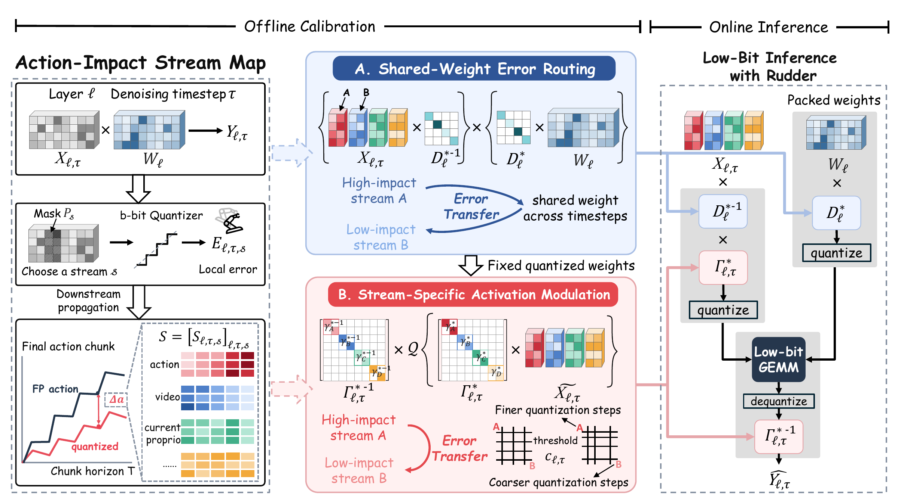

<h1 align="center">⎈ SteerQuant: Steering Quantization Error with Action-Guided Scaling in World–Action Models</h1>

<h3 align="center">
  Explore more on our <a href="https://cathyyw.github.io/Steerquant-Website/">Project Page</a>!
</h3>

<p align="center">
  <a href="#overview">Overview</a> ·
  <a href="#installation">Installation</a> ·
  <a href="#model-and-data">Model &amp; Data</a> ·
  <a href="#calibration">Calibration</a> ·
  <a href="#evaluation">Evaluation</a> ·
  <a href="#real-robot-evaluation">Real Robot</a>
</p>

## Overview

SteerQuant is a 4-bit quantization framework for world–action models that uses
action impact to guide shared channel scaling and stream-specific activation calibration.

<p align="center">
  
</p>

## Installation

**Requirements:** Linux, Python 3.10, NVIDIA SM80+ GPU, CUDA Toolkit 12.8
(with `nvcc`), Git, a C++ compiler, and EGL/OpenGL for headless simulation.

All results in our main success-rate and efficiency tables were obtained on NVIDIA RTX 4090 GPUs.

```bash
# Ubuntu system dependencies
sudo apt-get install git build-essential python3.10-dev python3.10-venv libegl1 libgl1 libglib2.0-0

# Clone the repository
git clone https://github.com/CathyyW/SteerQuant-copy.git
cd SteerQuant-copy
```

Use separate environments for LIBERO and RoboCasa. Activate the corresponding
environment before running subsequent commands.

### LIBERO

```bash
python3.10 -m venv .venv
source .venv/bin/activate
pip install -r requirements.txt
pip install -e .
```

### RoboCasa

```bash
python3.10 -m venv .venv-robocasa
source .venv-robocasa/bin/activate
pip install -r requirements-robocasa.txt
pip install -e .
git clone https://github.com/moojink/robocasa-cosmos-policy.git third_party/robocasa
git -C third_party/robocasa checkout edd9a328b3ec98050f42d194c1419307a79c4d87
pip install --no-deps -e third_party/robocasa
export MUJOCO_GL=egl PYOPENGL_PLATFORM=egl
python third_party/robocasa/robocasa/scripts/download_kitchen_assets.py
python third_party/robocasa/robocasa/scripts/setup_macros.py
```

## Model and Data

Both benchmarks use the same
[video tokenizer](https://huggingface.co/nvidia/Cosmos-Predict2-2B-Video2World).

```bash
hf download nvidia/Cosmos-Predict2-2B-Video2World tokenizer/tokenizer.pth \
  --local-dir checkpoints/video
```

### LIBERO

Download the [LIBERO policy checkpoint](https://huggingface.co/nvidia/Cosmos-Policy-LIBERO-Predict2-2B)
and its statistics and text embeddings:

```bash
hf download nvidia/Cosmos-Policy-LIBERO-Predict2-2B \
  Cosmos-Policy-LIBERO-Predict2-2B.pt libero_dataset_statistics.json libero_t5_embeddings.pkl \
  --local-dir checkpoints/policy
```

Generate calibration file from the public [LIBERO-Cosmos-Policy dataset](https://huggingface.co/datasets/nvidia/LIBERO-Cosmos-Policy):

```bash
hf download nvidia/LIBERO-Cosmos-Policy --repo-type dataset \
  --include 'success_only/*_regen/*.hdf5' 'success_only/dataset_statistics*.json' \
  --local-dir data/LIBERO-Cosmos-Policy
steerquant-prepare-calibration \
  --data-dir data/LIBERO-Cosmos-Policy/success_only --output-dir data/calibration
```

Output: `data/calibration/libero_calibration_320.pkl` (320 samples).

### RoboCasa

Download the [RoboCasa policy checkpoint](https://huggingface.co/nvidia/Cosmos-Policy-RoboCasa-Predict2-2B)
and its statistics and text embeddings:

```bash
hf download nvidia/Cosmos-Policy-RoboCasa-Predict2-2B \
  --revision 4b2a04c80d97202f86127ebec80461e8016ec1dc \
  Cosmos-Policy-RoboCasa-Predict2-2B.pt robocasa_dataset_statistics.json robocasa_t5_embeddings.pkl \
  --local-dir checkpoints/robocasa
```

Generate and validate the calibration file from the public
[RoboCasa-Cosmos-Policy dataset](https://huggingface.co/datasets/nvidia/RoboCasa-Cosmos-Policy):

```bash
steerquant-prepare-robocasa-calibration --output-dir data/robocasa-calibration
steerquant-prepare-robocasa-calibration --output-dir data/robocasa-calibration \
  --validate-only --t5-embeddings checkpoints/robocasa/robocasa_t5_embeddings.pkl
```

Output: `data/robocasa-calibration/robocasa_calibration_192.pkl` (192 samples).
The preparation command automatically downloads the required data.

## CUDA Kernels

Build **Rudder** (W4A8/W4A4 kernels) and run correctness tests:

```bash
steerquant-build
python -m pytest -q
```

The W4A4 Hadamard transform is included here for improved preprocessing.

## Calibration

### LIBERO

```bash
steerquant-calibrate --suite libero \
  --model-dir checkpoints/policy \
  --tokenizer checkpoints/video/tokenizer/tokenizer.pth \
  --calibration data/calibration/libero_calibration_320.pkl \
  --activation-bits 8 --output-dir outputs/w4a8
```

Output: `outputs/w4a8/steerquant_w4a8.pt`.

### RoboCasa

```bash
steerquant-calibrate --suite robocasa \
  --model-dir checkpoints/robocasa \
  --tokenizer checkpoints/video/tokenizer/tokenizer.pth \
  --calibration data/robocasa-calibration/robocasa_calibration_192.pkl \
  --activation-bits 8 --output-dir outputs/robocasa-w4a8
```

Output: `outputs/robocasa-w4a8/steerquant_w4a8.pt`.

Use a new output directory for each run. For **W4A4**, set `--activation-bits 4`
and use `--output-dir outputs/w4a4` for LIBERO or
`--output-dir outputs/robocasa-w4a4` for RoboCasa.

## Evaluation

### LIBERO

```bash
steerquant-evaluate \
  --model-dir checkpoints/policy \
  --tokenizer checkpoints/video/tokenizer/tokenizer.pth \
  --checkpoint outputs/w4a8/steerquant_w4a8.pt \
  --suite libero_spatial --trials 25 --backend cutlass --cuda-graph \
  --output-dir outputs/evaluation
```

Supported suites: `libero_spatial`, `libero_object`, `libero_goal`, and `libero_10`.
For W4A4, use `--checkpoint outputs/w4a4/steerquant_w4a4.pt`.
Logs are saved to the output directory;
rollout videos are saved under `rollouts/`.

### RoboCasa

Run the smoke check before formal evaluation, using the same method, checkpoint
and output directory for both steps:

```bash
export MUJOCO_GL=egl PYOPENGL_PLATFORM=egl PYTHONHASHSEED=0
for MODE in smoke run; do
  steerquant-evaluate-robocasa \
    --method w4a8 --mode "$MODE" --cuda-graph \
    --model-dir checkpoints/robocasa \
    --tokenizer checkpoints/video/tokenizer/tokenizer.pth \
    --checkpoint outputs/robocasa-w4a8/steerquant_w4a8.pt \
    --output-dir outputs/robocasa-720 || break
done
```

Each method runs 720 episodes. For **W4A4**, use `--method w4a4` and
`--checkpoint outputs/robocasa-w4a4/steerquant_w4a4.pt`. For **FP**, use
`--method fp` and omit `--checkpoint`.

Results are saved under `outputs/robocasa-720/{fp,w4a8,w4a4}/`.

## Real-robot evaluation

See [real_robot/README.md](real_robot/README.md) for FastWAMJoint W4A8
checkpoints, setup, and deployment.

## License

[Apache-2.0](LICENSE) · [Third-party notices](THIRD_PARTY.md)
